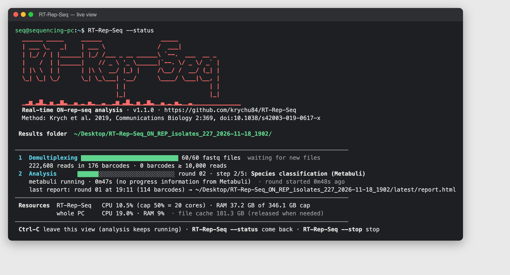
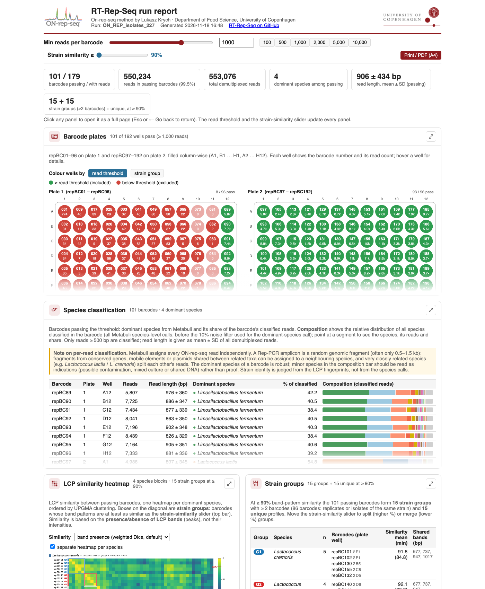
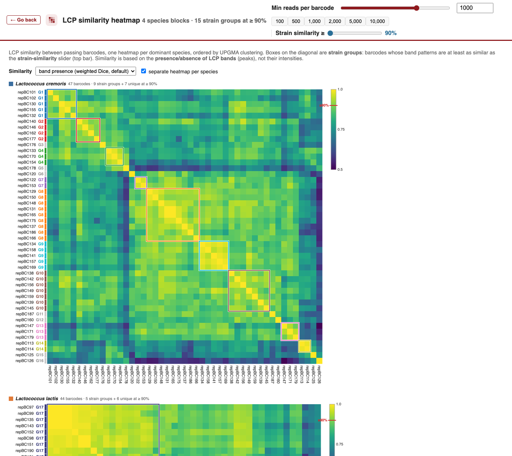
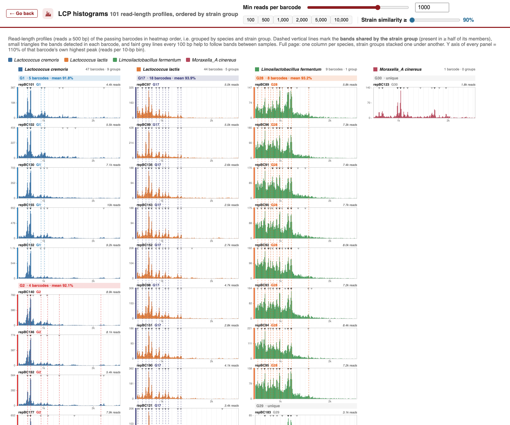
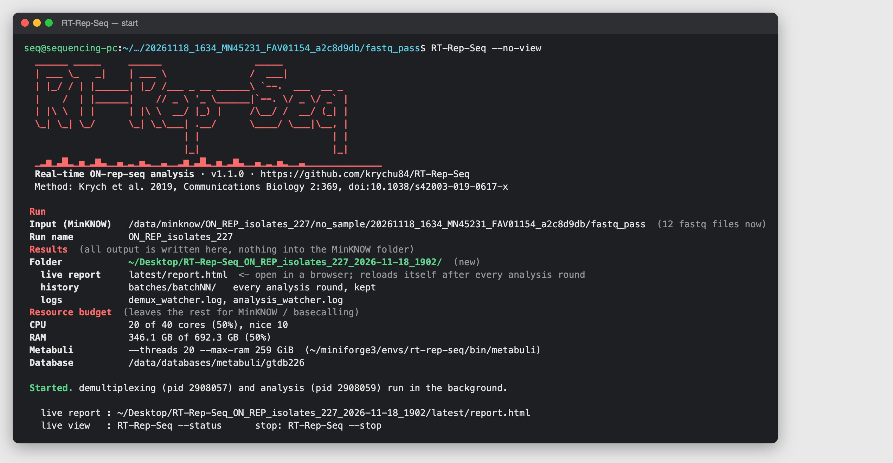
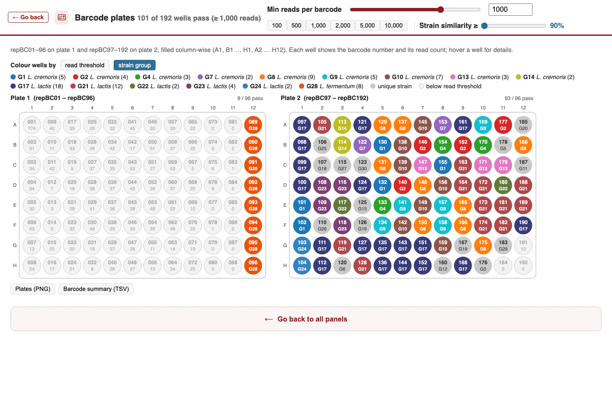

# RT-Rep-Seq

**Real-time ON-rep-seq analysis: species identification and strain-level grouping of bacterial isolates while the Oxford Nanopore sequencer is still running.**



[ON-rep-seq](https://doi.org/10.1038/s42003-019-0617-x) (Krych *et al.*, 2019) enriches bacterial genomic DNA with Rep-PCR, tags up to 96 isolates per reaction with nanopore-compatible barcodes and sequences them on Oxford Nanopore (ONT) flow cells. Each isolate yields a **read-length count profile (LCP)**, the sequencing equivalent of a Rep-PCR gel fingerprint that differs between strains, together with reads that identify the species.

RT-Rep-Seq runs the complete analysis **during sequencing**. It watches the folder MinKNOW writes to, demultiplexes every new file, classifies the reads, compares the LCPs, groups identical or highly similar strains, and keeps refreshing one interactive HTML report.

## Main features

- **Real time.** You start it once in the MinKNOW `fastq_pass` folder. New fastq files are demultiplexed exactly once, and the analysis is repeated automatically whenever new reads arrive. The open report reloads itself after each round.
- **Safe on the sequencing PC.** All processes together (including Metabuli) are limited to **50% of the CPU cores and 50% of the RAM** (Linux cgroup via `systemd-run`, CPU pinning, `nice`), so basecalling is never starved.
- **Clear terminal interface.** It shows the logo, the exact results folder, the resource budget, live progress bars for each step, and the CPU/RAM in use.
- **Species identification** with [Metabuli](https://github.com/steineggerlab/Metabuli) (amino-acid + DNA *k*-mers) against the GTDB, for reads ≥ 500 bp. Each barcode gets a composition bar showing all species called.
- **Strain grouping from LCP band patterns.**
  - Bands (peaks) are compared by **presence/absence**, not intensity, using a weighted Dice coefficient with a position tolerance, as for Rep-PCR gels.
  - Barcodes are clustered by UPGMA within each species.
  - A **strain-similarity slider (90–100%)** splits and merges strain groups live.
- **Interactive, self-contained HTML report** that works offline in any browser:
  - read-count threshold slider;
  - two **96-well plate maps** (pass/fail or coloured by strain group);
  - species table with read length (mean ± SD);
  - per-species similarity heatmaps with boxed strain groups;
  - strain-group table;
  - LCP histograms ordered by strain group, with shared-band reference lines;
  - publication-style **Materials and methods** with references;
  - TSV/PNG downloads and an A4 print layout.

| Report overview | Strain groups (similarity heatmap) | LCP histograms by strain group |
|---|---|---|
|  |  |  |

## How it works

```
MinKNOW fastq_pass/  ──►  1 Demultiplexing (torchlex: spacer–barcode–(GTG)5 anchors, Levenshtein ≤ 4)
   (new files)                     │  every file once, appended per barcode
                                   ▼
                          2 Species classification   Metabuli (reads ≥ 500 bp) vs GTDB
                          3 Read-length profiles      LCP per barcode
                          4 LCP similarity            band calling → weighted Dice → UPGMA → strain groups
                          5 HTML report               latest/report.html (+ batches/batchNN/ history)
                                   ▲
                          steps 2–5 repeat whenever new reads are demultiplexed
```

## Requirements

- Linux (developed and used on ONT P2 Solo host PCs and Linux servers) with `conda` ([Miniforge](https://github.com/conda-forge/miniforge) recommended). `systemd-run` (standard on systemd-based distributions) is needed to enforce the RAM cap.
- A Metabuli database. The pre-built **`gtdb226`** database (GTDB R226 + human T2T-CHM13v2.0 + RefSeq Virus, 378 GB) is recommended. Smaller alternatives include `refseq_standard` (111 GB); see the [Metabuli databases](https://jaebeom-kim.github.io/metabuli-doc/databases/new-database/).
- RAM: Metabuli is given `--max-ram` = 75% of the RAM budget, so it adapts to the machine. ≥ 64 GB total RAM is recommended. The database should be on a local disk (SSD preferred).

## Installation

```bash
# 1. get the code
git clone https://github.com/krychu84/RT-Rep-Seq.git
cd RT-Rep-Seq

# 2a. install with a Metabuli database you already have
./install.sh --db /path/to/metabuli/gtdb226

# 2b. ... or let the installer download one (378 GB; needs ~2x that free space while unpacking)
./install.sh --download-db gtdb226 --db-dir /data/databases/metabuli

# 3. open a new terminal (the installer adds ~/.local/bin to your PATH), then check
RT-Rep-Seq --version
```

`install.sh` performs five steps:

1. Checks for conda/mamba and `systemd-run`.
2. Creates the conda environment **`rt-rep-seq`** (Python 3.11, NumPy, SciPy, Biopython, Matplotlib, psutil, polyleven, Metabuli) from `environment.yml`.
3. Checks or downloads the database.
4. Writes `assets/rt-rep-seq.config.json`.
5. Installs the `RT-Rep-Seq` command in `~/.local/bin`.

Running it again is safe: it updates the environment. You can change the database later with `./install.sh --db …`.

Manual installation: `conda env create -f environment.yml`, copy `assets/rt-rep-seq.config.example.json` to `assets/rt-rep-seq.config.json`, set `gtdb_db` (and `metabuli_bin`), then run `./RT-Rep-Seq` with the environment's Python.

## Test run

A small simulated dataset (12 barcodes, 3 species, known strain groups, ~26 MB) is included:

```bash
test/run_test.sh
```

It imitates a sequencing run (files arrive one by one) and should give the result listed in
[test/README.md](test/README.md).

## Usage

```bash
# live run: go to the folder MinKNOW writes to and start
cd /data/<experiment>/<sample>/<YYYYMMDD_HHMM_..._flowcell>/fastq_pass
RT-Rep-Seq
```



At start, RT-Rep-Seq prints where everything goes:

```
~/Desktop/RT-Rep-Seq_<experiment>_<YYYY-MM-DD_HHMM>/
    latest/report.html      the live report: open it in a browser, it reloads itself after every analysis round
    batches/batchNN/        every analysis round (report + tables + figures), kept
    demultiplexed_fastq/    reads per barcode (repBC01.fastq …)
    demux_watcher.log  analysis_watcher.log  run_info.json
```

| Command | What it does |
|---|---|
| `RT-Rep-Seq` | start (or resume) the analysis of the current folder and show the live view |
| `Ctrl-C` | leave the live view; the analysis keeps running in the background |
| `RT-Rep-Seq --status` | re-open the live view of the running (or most recent) analysis |
| `RT-Rep-Seq --stop` | stop after the current analysis round (`--stop --now`: immediately) |
| `RT-Rep-Seq --no-view` | start and return to the prompt |
| `RT-Rep-Seq --min-reads 1000` | start with another read threshold (report slider start value; default 10,000) |

- **Finished runs** work the same way: start RT-Rep-Seq in the `fastq_pass` (or `barcodeNN`) folder of a completed run. All files are processed, and the live view shows *up to date* when the last round is finished.
- **Restarting** in the same folder resumes the same results folder, and files that were already demultiplexed are skipped.
- **Single pass from a script:**

  ```bash
  python rt_rep_seq.py --input-dir fastq_pass --gtdb-db /path/to/gtdb226 --metabuli-bin "$(which metabuli)" \
         --results-dir results --num-barcodes 96
  ```

- **Rebuilding a report** (e.g. with another start threshold): `python interactive_report.py --results-dir <...>/latest --threshold 1000`

### Settings (`assets/rt-rep-seq.config.json`)

| key | default | meaning |
|---|---|---|
| `gtdb_db` | | Metabuli database folder (required) |
| `metabuli_bin` / `metabuli_env` | written by install.sh | the Metabuli executable, or the name of a conda env that contains it |
| `cpu_frac`, `mem_frac` | 0.5, 0.5 | share of CPU cores / RAM RT-Rep-Seq may use |
| `threads` | `"auto"` | Metabuli threads (auto = all cores of the CPU budget) |
| `min_reads` | 10000 | QC threshold: start value of the report's read slider, and the static PNG figures |
| `analysis_min_reads` | 1 | barcodes with at least this many reads are analysed (the slider can go down to this) |
| `db_description` | | optional: how to describe the database in the report's Methods |

Command-line options of the engine (`python rt_rep_seq.py --help`) include `--min-read-length` (500 bp), `--min-species-pct` (10%), `--lcp-bin-bp` (10 bp) and `--metabuli-max-ram`.

## The report

| Panel | Content |
|---|---|
| **Barcode plates** | repBC01–96 on plate 1 and repBC97–192 on plate 2, column-wise (A1, B1 … H12). Wells are coloured by read threshold (green/red) or by strain group |
| **Species classification** | reads, read length (mean ± SD), dominant species and its share, and a composition bar of all species Metabuli called (hover a segment for details) |
| **LCP similarity heatmap** | one heatmap per species. Strain groups at the current similarity threshold are boxed on the diagonal |
| **Strain groups** | members (plate/well), mean (min) similarity, and bands shared by the group |
| **LCP histograms** | ordered by species and strain group. Dashed lines mark bands shared by the group, triangles mark the bands of each barcode. In full page view, one column per species |
| **Materials and methods** | wet lab, sequencing and bioinformatics, with the exact parameters and software versions of the run, plus references (copy/download as text) |



Every panel opens full page on click (**← Go back** returns). Two sliders drive everything: **minimum reads per barcode** and **strain similarity (90–100%)**.

**Interpreting species calls.** Metabuli classifies every read, which is one Rep-PCR amplicon, on its own. Amplicons from conserved genes, mobile elements or plasmids can be assigned to related species, and near-identical species (e.g. *Lactococcus lactis* / *L. cremoris*) split each other's reads. The dominant species of a barcode is robust. Minor species are indications (contamination, mixed culture, shared DNA), not proof. Strain identity is judged from the LCP fingerprints.

**Strain-grouping parameters** (`lcp_peaks.py`):

- **Band calling:** 5-bp grid, Gaussian σ = 10 bp. A band needs a prominence of ≥ 4% of the strongest band and ≥ 2 reads per bin.
- **Weights:** band weight = relative prominence, with full weight from 50% of the strongest band.
- **Matching:** bands match within max(20 bp, 2% of length).
- **Calibration:** eight technical replicates (one DNA, eight Rep-PCR wells) form a single group at ≥ 90%, and different species never exceed 0.77.

## Citation

If you use RT-Rep-Seq, please cite the ON-rep-seq method and this repository:

> Krych, Ł., Castro-Mejía, J. L., Forero-Junco, L. M., Moesby, D. N., Mikkelsen, M. B., Rasmussen, M. A., Sykulski, M. & Nielsen, D. S. DNA enrichment and tagmentation method for species-level identification and strain-level differentiation using ON-rep-seq. *Communications Biology* **2**, 369 (2019). https://doi.org/10.1038/s42003-019-0617-x

> RT-Rep-Seq: real-time ON-rep-seq analysis. https://github.com/krychu84/RT-Rep-Seq

Please also cite the third-party tools and the database (below), at least Metabuli and GTDB.

## Third-party tools and databases

| Tool / resource | Used for | Reference |
|---|---|---|
| **Metabuli** (≥ 1.2.0) | taxonomic classification of reads (joint amino-acid and DNA *k*-mer matching) | Kim, J. & Steinegger, M. Metabuli: sensitive and specific metagenomic classification via joint analysis of amino acid and DNA. *Nat. Methods* **21**, 971–973 (2024). [doi:10.1038/s41592-024-02273-y](https://doi.org/10.1038/s41592-024-02273-y) · [github.com/steineggerlab/Metabuli](https://github.com/steineggerlab/Metabuli) |
| **GTDB** (Genome Taxonomy Database), release R226 in the `gtdb226` Metabuli database | reference genomes and taxonomy for species assignment | Parks, D. H. *et al.* GTDB: an ongoing census of bacterial and archaeal diversity through a phylogenetically consistent, rank normalized and complete genome-based taxonomy. *Nucleic Acids Res.* **50**, D785–D794 (2022). [doi:10.1093/nar/gkab776](https://doi.org/10.1093/nar/gkab776) · [gtdb.ecogenomic.org](https://gtdb.ecogenomic.org) |
| **Human T2T-CHM13v2.0** (in `gtdb226`) | identifies human reads | Nurk, S. *et al.* The complete sequence of a human genome. *Science* **376**, 44–53 (2022). [doi:10.1126/science.abj6987](https://doi.org/10.1126/science.abj6987) |
| **NCBI RefSeq Virus** (in `gtdb226`) | identifies viral/phage reads | O'Leary, N. A. *et al.* Reference sequence (RefSeq) database at NCBI: current status, taxonomic expansion, and functional annotation. *Nucleic Acids Res.* **44**, D733–D745 (2016). [doi:10.1093/nar/gkv1189](https://doi.org/10.1093/nar/gkv1189) |
| **torchlex** (bundled, `torchlex/`) | demultiplexing of ON-rep-seq reads by spacer–barcode–(GTG)<sub>5</sub> anchors | Part of the **RubyRed** pipeline (Reilly, E. & Krych, Ł. RubyRed, [github.com/reillyeo/RubyRed](https://github.com/reillyeo/RubyRed)); [torchlex method note](https://nanoporetech.com/resource-centre/torchlex-method-real-time-demultiplexing-barcoded-oxford-nanopore-reads). Bundled here in a version adapted to the repBC barcode set. Contact: Gjorgji Madjarov, gjorgji.madjarov@finki.ukim.mk |
| **polyleven** | fast Levenshtein distances for barcode matching | Fujimoto, S. polyleven. [github.com/fujimotos/polyleven](https://github.com/fujimotos/polyleven) |
| **Biopython** | FASTQ parsing, sequence utilities | Cock, P. J. A. *et al.* Biopython: freely available Python tools for computational molecular biology and bioinformatics. *Bioinformatics* **25**, 1422–1423 (2009). [doi:10.1093/bioinformatics/btp163](https://doi.org/10.1093/bioinformatics/btp163) |
| **NumPy** | numerical arrays | Harris, C. R. *et al.* Array programming with NumPy. *Nature* **585**, 357–362 (2020). [doi:10.1038/s41586-020-2649-2](https://doi.org/10.1038/s41586-020-2649-2) |
| **SciPy** | peak calling, smoothing, hierarchical clustering | Virtanen, P. *et al.* SciPy 1.0: fundamental algorithms for scientific computing in Python. *Nat. Methods* **17**, 261–272 (2020). [doi:10.1038/s41592-019-0686-2](https://doi.org/10.1038/s41592-019-0686-2) |
| **Matplotlib** | static PNG figures | Hunter, J. D. Matplotlib: a 2D graphics environment. *Comput. Sci. Eng.* **9**, 90–95 (2007). [doi:10.1109/MCSE.2007.55](https://doi.org/10.1109/MCSE.2007.55) |
| **psutil** | CPU/RAM monitoring | Rodola, G. psutil. [github.com/giampaolo/psutil](https://github.com/giampaolo/psutil) |
| **Bioconda / conda-forge** | software distribution | Grüning, B. *et al.* Bioconda: sustainable and comprehensive software distribution for the life sciences. *Nat. Methods* **15**, 475–476 (2018). [doi:10.1038/s41592-018-0046-7](https://doi.org/10.1038/s41592-018-0046-7) |
| Dice coefficient, UPGMA | LCP similarity and strain clustering | Dice, L. R. *Ecology* **26**, 297–302 (1945). [doi:10.2307/1932409](https://doi.org/10.2307/1932409) · Sokal, R. R. & Michener, C. D. *Univ. Kansas Sci. Bull.* **38**, 1409–1438 (1958) |
| Rep-PCR | basis of ON-rep-seq | Versalovic, J., Schneider, M., de Bruijn, F. J. & Lupski, J. R. Genomic fingerprinting of bacteria using repetitive sequence-based polymerase chain reaction. *Methods Mol. Cell. Biol.* **5**, 25–40 (1994) |
| Original ON-rep-seq pipeline | reference implementation of the method | [github.com/lauramilena3/On-rep-seq](https://github.com/lauramilena3/On-rep-seq) · [on-rep-seq.readthedocs.io](https://on-rep-seq.readthedocs.io) · v1.2: [doi:10.5281/zenodo.3384842](https://doi.org/10.5281/zenodo.3384842) |
| MinKNOW (Oxford Nanopore Technologies) | sequencing control and live basecalling (not distributed; RT-Rep-Seq reads its output) | [nanoporetech.com](https://nanoporetech.com) |

## Licence

MIT, see [LICENSE](LICENSE). The bundled `torchlex/` package is part of RubyRed and keeps its authors' terms (contact: Gjorgji Madjarov, gjorgji.madjarov@finki.ukim.mk). The databases and third-party tools keep their own licences.

Developed at the Department of Food Science, University of Copenhagen. Questions and bug reports: [GitHub issues](https://github.com/krychu84/RT-Rep-Seq/issues).
